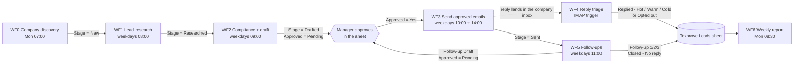

# Texprove n8n Sales Automation

Seven n8n workflows that run Texprove's B2B cold outreach to Turkish textile exporters selling into the EU: find companies, research a decision maker, write a compliant first email, get it approved by a human, send it, follow up, classify replies, and report every Monday.

A Google Sheet is the only shared state. The workflows never call each other: each one reads rows at a given `Stage`, does its job, writes the next `Stage`, and a person (the sales manager) approves every outbound email from the sheet. HubSpot is written to only when an email goes out or a reply arrives, to stay within the free plan's 3,000 actions a month.

This repository holds the workflow exports in n8n's import format plus the documentation needed to run them.

## Contents

| Path | What it is |
|---|---|
| `WF0-company-discovery.json` | Finds new Turkish EU-exporting manufacturers every Monday |
| `WF1-lead-research.json` | Researches each new company: contact, title, email, hook |
| `WF2-compliance-and-draft.json` | Code-based compliance rules, writes the first email, checks the text, asks for approval |
| `WF3-send-first-email.json` | Sends approved drafts from the company mailbox (SMTP; Gmail optional), logs to HubSpot, HubSpot quota gate, inbox-placement copy every 12 sends |
| `WF4-reply-triage.json` | Classifies replies (Hot / Warm / Cold / Not interested / Auto-reply), alerts on Hot |
| `WF5-follow-ups.json` | Drafts follow-ups at day 4 / 10 / 20, approval gate, sends in the same thread, closes silent leads |
| `WF6-weekly-report.json` | Monday report and three LinkedIn post drafts |
| `Test-telegram-group-message.json` | One-node manual test that posts to the Telegram alerts group |
| `docs/workflows.md` | What each workflow does, step by step, what it reads and writes, what to edit |
| `docs/google-sheet.md` | Sheet tabs, exact column headers, Settings fields, Stage values |
| `docs/setup-guide.md` | Step-by-step setup of everything: sheet, every credential (Anthropic, Sheets, HubSpot, SMTP/IMAP or Gmail, Telegram), which nodes each goes on, tests, go-live, self-hosting n8n |
| `docs/setup.md` | Import, credentials, test mode, manual test order, go-live checklist |
| `docs/manager-guide.md` | The daily routine for the person approving emails (no n8n access needed) |
| `docs/design-decisions.md` | Why it is built this way, deviations from the original plan, known limits, cost |

## How the pipeline fits together

Every workflow also appends one row per decision to a `Log` tab (the 12-month decision record) and checks a `Suppression` tab of addresses and domains that must never be contacted.

## Workflow summary

| Workflow | Runs | Reads rows where | Writes | AI |
|---|---|---|---|---|
| WF0 Company discovery | Monday 07:00 | whole Leads tab (duplicate check) | new rows, Stage `New`, source URL + confidence | Claude Sonnet 5.5 with built-in web search |
| WF1 Lead research | weekdays 08:00 | Stage `New` (10 per run) | contact, hook, notes; Stage `Researched` | Claude Sonnet 5.5 with built-in web search |
| WF2 Compliance check and draft | weekdays 09:00 | Stage `Researched` (20 per run) | Compliance Status, Subject, Draft Body (+EN); Stage `Drafted` or `Blocked - Compliance` | code rules, Claude Sonnet 5.5 (draft), Claude Haiku 5.5 (translation) |
| WF3 Send approved emails | weekdays 10:00 and 14:00 | Stage `Drafted`, Approved `Yes` (15 per run) | Sent At, thread ID, HubSpot ID; Stage `Sent` | none |
| WF4 Reply triage | IMAP trigger on the company inbox (or Gmail poll every 15 min) | row matching the thread / Message-ID | Reply Category, Reply Summary; Stage `Replied - …` or `Opted out` | Claude Haiku 5.5 |
| WF5 Follow-ups | weekdays 11:00 | Stage `Sent` / `Follow-up 1` / `Follow-up 2` with a due date | Follow-up Draft, then Follow-up Count, next date; Stage `Follow-up 1/2/3`, `Closed - No reply` | Claude Sonnet 5.5 |
| WF6 Weekly report and LinkedIn drafts | Monday 08:30 | whole Leads tab | report to the manager; 3 rows in `Social` | Claude Sonnet 5.5 |

Manager notifications (approval requests, Hot-reply alerts, follow-up summaries, weekly report, LinkedIn drafts) go out on two channels at once: email (company SMTP, or Gmail) and Telegram. WhatsApp was removed on 2026-11-13. Every notification node continues on error, so one failing channel never blocks the others or the run.

## Quick start

1. Create the Google Sheet with the tabs and headers in [docs/google-sheet.md](docs/google-sheet.md) and fill the `Settings` row.
2. In n8n, create the credentials described step by step in [docs/setup-guide.md](docs/setup-guide.md) (Anthropic, Google Sheets, SMTP + IMAP or Gmail, HubSpot, Telegram).
3. Import each `WF*.json` with **Workflows > Import from File**, re-select the credentials on every node, and point the Google Sheets nodes at your sheet. The exports reference credentials by **name only** (`Google Sheets account`, `Anthropic account`, `Anthropic account 2`, `HubSpot Service Key account`, `SMTP account`, `IMAP account`, `Telegram account`, `Gmail account`); no ids, keys or tokens are included, so name your credentials the same way. On a self-hosted server n8n may still not attach them by name; if a node shows no credential after import, select it by hand.
4. Put your own address in `Settings > Test Email` so nothing reaches a real lead, then run the workflows by hand in the order given in [docs/setup.md](docs/setup.md).
5. Clear `Test Email`, finish the go-live checklist, and activate the workflows one at a time.

All workflows are shipped **inactive** and should stay that way until the checklist is done.

## Switching from test mode to production

Test mode is a single cell: **`Settings` tab → `Test Email` (row 2)** in the Texprove Leads sheet.

- While it holds an address, every first email and follow-up goes to that address instead of the lead, and the HubSpot contact is created for that address too.
- When it is empty, WF3 sends first emails to the real lead addresses, follow-ups (WF5) go out in those same threads, and HubSpot records the real contacts. Nothing has to change in n8n.

Before you empty it, fix these, or real companies receive emails with test details:

1. In the same `Settings` row, check the signature fields (`Sender Name` Nil Sızır, `Sender Title` Founder & CEO, `Company Legal Name`, `Company Address` = the Ankara office, set 2026-11-13), and change `Nil Email` and `Nil Telegram Chat ID` from the test values to the manager's. Drafts already in the sheet keep the text they were written with.
2. Send from the company mailbox (next section), not a personal Gmail. A personal Gmail sending cold email gets flagged as spam quickly. The exports already use `Mail Provider` = `SMTP` with marketing@texprove.com.
3. Agree with the manager that only rows with `Approved = Yes` are ever sent.

Then switch on the schedules for WF2, WF3, WF5 and WF6 (and WF4 if it is not on yet), one at a time.

## Connecting the company mailbox (texprove.com)

The workflows can send and read mail in two ways, chosen by one cell: **`Settings` tab → `Mail Provider`** (row 2).

| `Mail Provider` | Sends with | Reads replies with | Use it for |
|---|---|---|---|
| `Gmail` (or empty) | Gmail OAuth2 credential | Gmail Trigger | Gmail or Google Workspace mailboxes |
| `SMTP` | SMTP credential | IMAP Trigger | any other mail server, including texprove.com |

texprove.com mail is **not** on Google: its MX record points at a self-hosted server (`mail.texprove.com`), so the company mailbox needs the SMTP option. **Since 2026-11-13 the exports ship in SMTP mode** (SMTP/IMAP nodes enabled, Gmail nodes disabled) and the live sheet has `Mail Provider` = `SMTP`, `SMTP From` = `Texprove <marketing@texprove.com>`. Tested end to end on 2026-11-13: send, reply matching, Warm and Hot classification, Hot alert by email and Telegram. To go back to Gmail, reverse the table in Option B and set `Mail Provider` = `Gmail`.

The switch is a sheet cell and not automatic because n8n refuses to activate a workflow while an enabled node has no credential, so "no Gmail credential" can't be detected while a workflow runs. Instead, each mail step has a Gmail node and an SMTP node; the cell decides which one runs, and you disable the nodes of the provider you don't use. If the cell and the enabled nodes disagree, WF3 and WF5 stop with an error before marking anything as sent (`Stop: SMTP not sent`, `Stop: Gmail not sent`, and the same for follow-ups).

### Option A: Gmail or Google Workspace

1. In n8n, go to **Overview → Create credential → Gmail OAuth2 API**, click **Sign in with Google** and log in with the address you send from. Name it `Gmail account`.
2. If Google blocks the sign-in with "app not allowed", a Workspace admin allows it in **admin.google.com → Security → API controls → App access control**.
3. Select the credential on every Gmail node in WF2–WF6 (12 nodes): WF2 `Notify Nil`; WF3 `Send Email`, `Warn Nil Quota`; WF4 `Gmail Trigger`, `Mark Reply Read`, `Alert Nil`; WF5 `Get Thread`, `Get Original Message-ID`, `Send Follow-up`, `Email Nil (follow-ups)`; WF6 `Email Weekly Report`, `Email Social Drafts Ready`.
4. Set `Mail Provider` = `Gmail`, enable the Gmail nodes above and disable the `(SMTP)` nodes and the `IMAP Trigger` (the reverse of the Option B table).

### Option B: SMTP + IMAP (texprove.com, current setup)

1. Get the mailbox login from whoever runs `mail.texprove.com`: the address (for example `sales@texprove.com`), its password, and the server settings. Typical values are SMTP `mail.texprove.com` port 465 (SSL/TLS) or 587 (STARTTLS), and IMAP `mail.texprove.com` port 993 (SSL/TLS).
2. In n8n create two credentials: **SMTP** (name `SMTP account`: host, port, user, password, SSL/TLS on for 465) and **IMAP** (name `IMAP account`: host, port 993, user, password, SSL/TLS on).
3. In the sheet's `Settings` row set `Mail Provider` = `SMTP` and `SMTP From` = the sender, currently `Texprove <marketing@texprove.com>`.
4. In n8n, select the new credentials on the SMTP/IMAP nodes. In the exports these are already enabled and the Gmail nodes they replace already disabled:

| Workflow | Enable and set the credential | Disable |
|---|---|---|
| WF2 | `Notify Nil (SMTP)` | `Notify Nil` |
| WF3 | `Send Email (SMTP)`, `Warn Nil Quota (SMTP)` | `Send Email`, `Warn Nil Quota` |
| WF4 | `IMAP Trigger`, `Alert Nil (SMTP)` | `Gmail Trigger`, `Mark Reply Read`, `Alert Nil` |
| WF5 | `Send Follow-up (SMTP)`, `Email Nil (follow-ups, SMTP)` | `Get Thread`, `Get Original Message-ID`, `Send Follow-up`, `Email Nil (follow-ups)` |
| WF6 | `Email Weekly Report (SMTP)`, `Email Social Drafts Ready (SMTP)` | `Email Weekly Report`, `Email Social Drafts Ready` |

5. Keep `Test Email` set, approve one test row and run WF3, reply to it, and check that WF4 picks the reply up and WF5 sends a follow-up. Then go live as in the section above.

What changes with SMTP:

- The `Gmail Thread ID` column holds `smtp:<Message-ID>` for those leads.
- WF4 matches a reply to its lead by the `In-Reply-To` / `References` headers, then by the sender's address, then by subject. The last two only consider leads at `Sent` or `Follow-up 1–3`.
- Follow-ups go out as `Re: <subject>`. Most mail apps group them with the first email, but they are not threaded the way Gmail threads them.
- WF5 can't check the thread for a reply before sending a follow-up, so it relies on WF4 having moved replied leads out of `Sent` / `Follow-up` first. Keep WF4 active.
- SMTP doesn't save a copy in the mailbox's Sent folder. Every email is still recorded in HubSpot and in the `Log` tab.
- IMAP marks each processed message as read. The trigger only sees unread messages.

### Before real sending (either option)

- Whoever manages the texprove.com domain should check that **SPF, DKIM and DMARC** cover the sending server. texprove.com already publishes a DMARC policy of quarantine/reject, so mail that fails SPF or DKIM will be junked or bounced.
- Start slowly, about 10–15 emails a day for the first couple of weeks. WF3 already caps each run at 15.
- **Inbox-placement check.** Every `Seed Every` first emails (Settings column T, 12 by default) WF3 sends an identical copy of the last email (same sender, subject and text) to `Seed Email` (Settings column S). If that copy lands in Spam, slow down and check the content and DNS. Leave `Seed Email` empty to turn it off. It covers first emails only, and only through SMTP. Gmail shows one provider's view; add an Outlook address later for a second opinion.
- Replies land in the company inbox and WF4 marks each one as read after processing it. Anyone who also reads that inbox by hand should check the sheet's `Reply Summary` column.

## Stack

- [n8n](https://n8n.io) (Cloud or self-hosted, workflow execution order v1, timezone Europe/Istanbul; self-hosting steps in [docs/setup-guide.md](docs/setup-guide.md#9-self-hosting-n8n))
- Anthropic Claude via n8n's Anthropic node and chat-model sub-nodes (Sonnet 5.5, Haiku 5.5, with a second-account fallback on every call)
- Google Sheets (source of truth), the texprove.com mailbox over SMTP/IMAP (or Gmail) for sending and the reply trigger, HubSpot free plan (contact and engagement log)
- A Telegram bot (and email) for manager notifications

## Status

Built and tested end to end with test addresses in October 2026 (WF2 → WF3 → WF4 → WF5 → WF6, including the follow-up approval gate and Hot-reply alerts). Not yet live. See the open items in [docs/design-decisions.md](docs/design-decisions.md).

## Export history

- 2026-11-14: re-exported from the new self-hosted server (n8n.mowassirnoor.tech) after the 2026-11-13 changes: company mail (SMTP/IMAP enabled, Gmail nodes disabled), WhatsApp notification nodes removed from WF2, WF4, WF5 and WF6, WF2 greeting rule (company-team greeting when no contact name is known), WF3 inbox-placement copy (`Seed check`, `Send Seed Copy (SMTP)`), and credential names for every node including `Anthropic account 2` on the fallback models.
- 2026-11-13: re-exported from the self-hosted Railway instance before moving to a new n8n server. Workflow logic is unchanged from the 2026-11-05 exports (WF3 and WF4 were checked node by node against the live versions); credential ids were removed so the files import cleanly on any instance, and the Telegram group test workflow was added.
