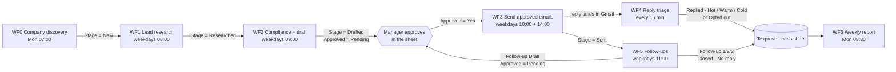

# Texprove n8n Sales Automation

Seven n8n workflows that run Texprove's B2B cold outreach to Turkish textile exporters selling into the EU: find companies, research a decision maker, write a compliant first email, get it approved by a human, send it, follow up, classify replies, and report every Monday.

A Google Sheet is the only shared state. The workflows never call each other: each one reads rows at a given `Stage`, does its job, writes the next `Stage`, and a person (the sales manager) approves every outbound email from the sheet. HubSpot is written to only when an email goes out or a reply arrives, to stay within the free plan's 3,000 actions a month.

This repository holds the workflow exports in n8n's import format plus the documentation needed to run them.

## Contents

| Path | What it is |
|---|---|
| `WF0-company-discovery.json` | Finds new Turkish EU-exporting manufacturers every Monday |
| `WF1-lead-research.json` | Researches each new company: contact, title, email, hook |
| `WF2-compliance-and-draft.json` | Code-based compliance rules, writes the first email, checks the text, asks for approval |
| `WF3-send-first-email.json` | Sends approved drafts from Gmail, logs to HubSpot, HubSpot quota gate |
| `WF4-reply-triage.json` | Classifies replies (Hot / Warm / Cold / Not interested / Auto-reply), alerts on Hot |
| `WF5-follow-ups.json` | Drafts follow-ups at day 4 / 10 / 20, approval gate, sends in the same thread, closes silent leads |
| `WF6-weekly-report.json` | Monday report and three LinkedIn post drafts |
| `docs/workflows.md` | What each workflow does, step by step, what it reads and writes, what to edit |
| `docs/google-sheet.md` | Sheet tabs, exact column headers, Settings fields, Stage values |
| `docs/setup.md` | Import, credentials, test mode, manual test order, go-live checklist |
| `docs/manager-guide.md` | The daily routine for the person approving emails (no n8n access needed) |
| `docs/design-decisions.md` | Why it is built this way, deviations from the original plan, known limits, cost |

## How the pipeline fits together

Every workflow also appends one row per decision to a `Log` tab (the 12-month decision record) and checks a `Suppression` tab of addresses and domains that must never be contacted.

## Workflow summary

| Workflow | Runs | Reads rows where | Writes | AI |
|---|---|---|---|---|
| WF0 Company discovery | Monday 07:00 | whole Leads tab (duplicate check) | new rows, Stage `New`, source URL + confidence | Claude Sonnet 5.5 with built-in web search |
| WF1 Lead research | weekdays 08:00 | Stage `New` (10 per run) | contact, hook, notes; Stage `Researched` | Claude Sonnet 5.5 with built-in web search |
| WF2 Compliance check and draft | weekdays 09:00 | Stage `Researched` (20 per run) | Compliance Status, Subject, Draft Body (+EN); Stage `Drafted` or `Blocked - Compliance` | code rules, Claude Sonnet 5.5 (draft), Claude Haiku 5.5 (translation) |
| WF3 Send approved emails | weekdays 10:00 and 14:00 | Stage `Drafted`, Approved `Yes` (15 per run) | Sent At, thread ID, HubSpot ID; Stage `Sent` | none |
| WF4 Reply triage | Gmail poll every 15 min | row matching the Gmail thread | Reply Category, Reply Summary; Stage `Replied - …` or `Opted out` | Claude Haiku 5.5 |
| WF5 Follow-ups | weekdays 11:00 | Stage `Sent` / `Follow-up 1` / `Follow-up 2` with a due date | Follow-up Draft, then Follow-up Count, next date; Stage `Follow-up 1/2/3`, `Closed - No reply` | Claude Sonnet 5.5 |
| WF6 Weekly report and LinkedIn drafts | Monday 08:30 | whole Leads tab | report to the manager; 3 rows in `Social` | Claude Sonnet 5.5 |

Manager notifications (approval requests, Hot-reply alerts, follow-up summaries, weekly report, LinkedIn drafts) go out on three channels at once: email (Gmail), WhatsApp Business Cloud and Telegram. Every notification node continues on error, so one failing channel never blocks the others or the run.

## Quick start

1. Create the Google Sheet with the tabs and headers in [docs/google-sheet.md](docs/google-sheet.md) and fill the `Settings` row.
2. In n8n, create the credentials listed in [docs/setup.md](docs/setup.md) (Anthropic, Google Sheets, Gmail, HubSpot, WhatsApp, Telegram).
3. Import each `WF*.json` with **Workflows > Import from File**, re-select the credentials on every node, and point the Google Sheets nodes at your sheet.
4. Put your own address in `Settings > Test Email` so nothing reaches a real lead, then run the workflows by hand in the order given in [docs/setup.md](docs/setup.md).
5. Clear `Test Email`, finish the go-live checklist, and activate the workflows one at a time.

All workflows are shipped **inactive** and should stay that way until the checklist is done.

## Stack

- [n8n](https://n8n.io) (Cloud or self-hosted, workflow execution order v1, timezone Europe/Istanbul)
- Anthropic Claude via n8n's Anthropic node and chat-model sub-nodes (Sonnet 5.5, Haiku 5.5, with a second-account fallback on every call)
- Google Sheets (source of truth), Gmail (sending and reply trigger), HubSpot free plan (contact and engagement log)
- WhatsApp Business Cloud API and a Telegram bot for manager notifications

## Status

Built and tested end to end with test addresses in October 2026 (WF2 → WF3 → WF4 → WF5 → WF6, including the follow-up approval gate and Hot-reply alerts). Not yet live. See the open items in [docs/design-decisions.md](docs/design-decisions.md).
